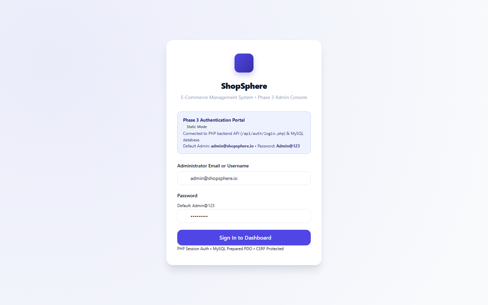
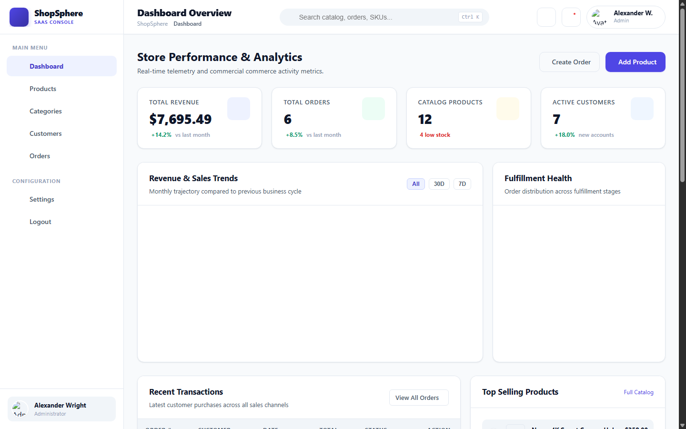
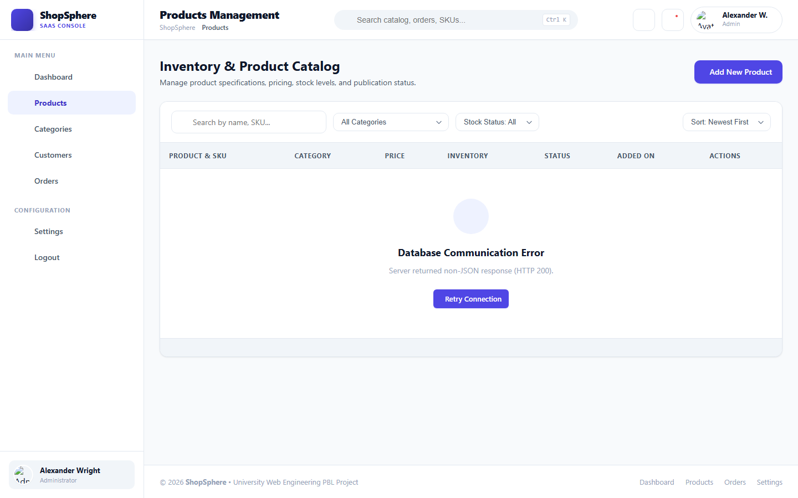
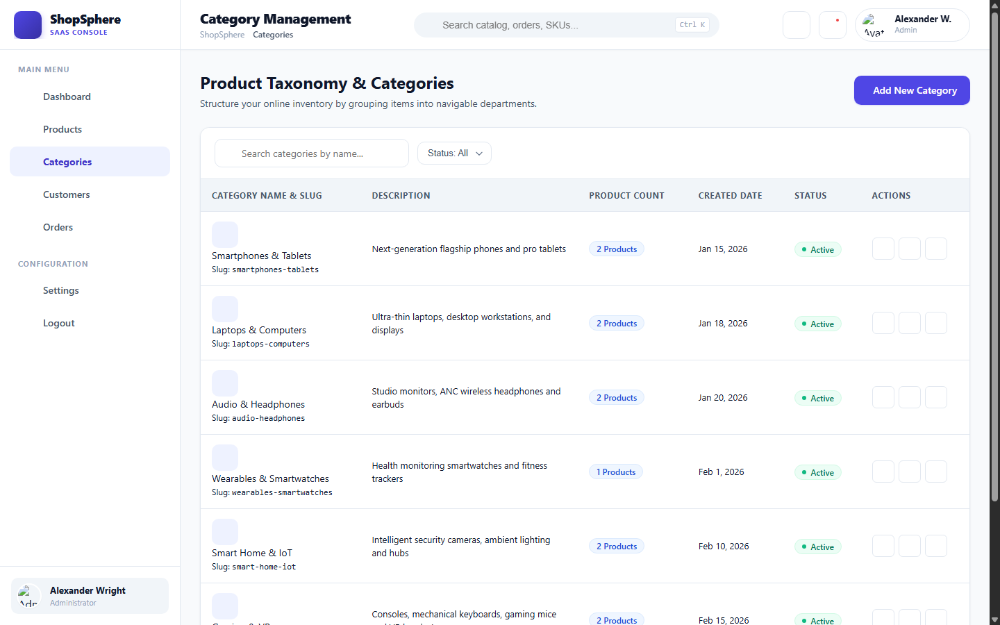
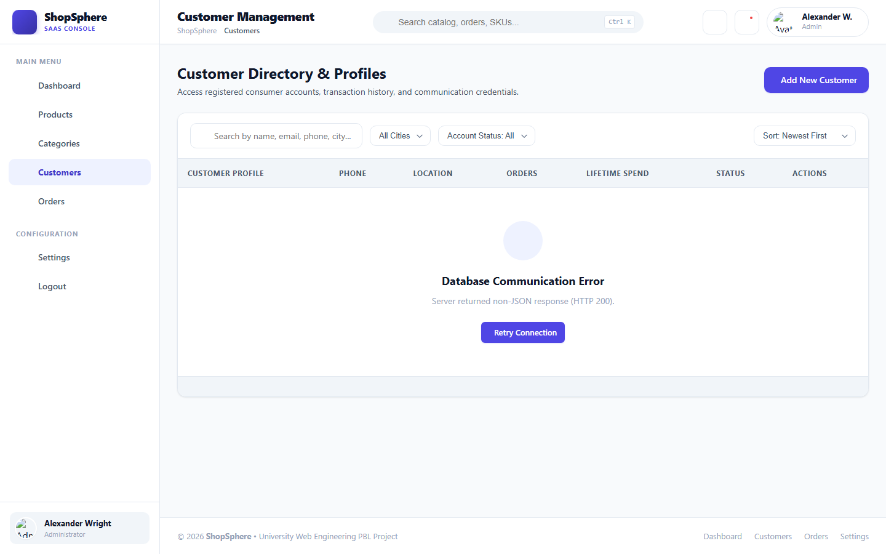
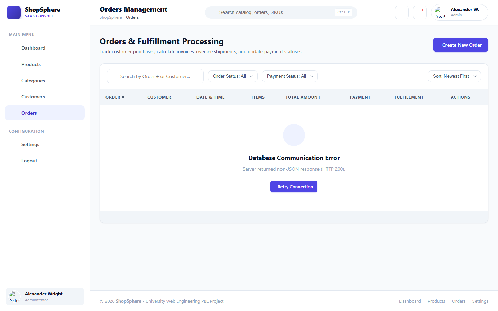
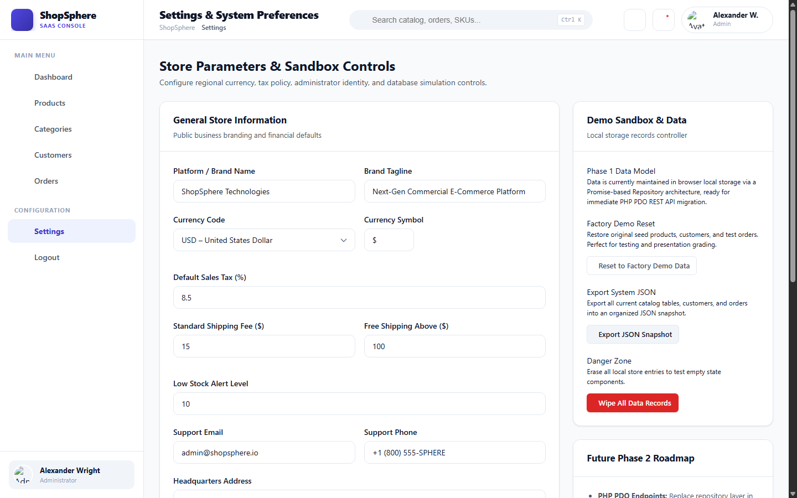

# ShopSphere – E-Commerce Management System

> A commercial-grade, full-stack administrative platform for modern retail e-commerce operations. Built with pure semantic HTML5, modern CSS3, Vanilla JavaScript (ES6+), PHP 8+, and a normalized MySQL database on the InnoDB storage engine.

[](https://www.php.net/)
[](https://www.mysql.com/)
[](https://developer.mozilla.org/)
[](LICENSE)
[-success.svg)](docs/TESTING_REPORT.md)

---

## 1. Project Overview

**ShopSphere** is an e-commerce administration console developed for university Web Engineering Project-Based Learning (SW417). It provides store owners and warehouse managers with full control over catalog inventories, department taxonomies, customer accounts, and order processing.

Unlike many modern web applications that rely on heavy external frontend frameworks (e.g. React/Vue) or complex backend frameworks (e.g. Laravel), ShopSphere delivers SaaS-level polish using **100% native web technologies**:
- **Zero Framework Overhead**: Runs directly on any Apache + PHP 8 + MySQL (XAMPP) stack without build steps or `node_modules`.
- **ACID Transaction Guarantees**: Multi-table checkouts and cancellations execute within atomic database transactions with row-level locks (`SELECT ... FOR UPDATE`).
- **Defense-in-Depth Security**: Parameterized PDO queries, cryptographic CSRF tokens, session hardening, and HTML output escaping.

---

## 2. Key Features

- **Executive Analytics Dashboard**: Real-time sales metrics, order fulfillment doughnut chart, 12-month revenue velocity line chart, and low-stock restock triggers.
- **Product Catalog CRUD**: Manage items with unique SKUs, stock levels, pricing, category filtering, and multipart media image upload with secure server-side validation.
- **Category Taxonomy CRUD**: Organize departments with live assigned product counters (`COUNT(p.id)`), auto-generated URL slugs, and safe relational decoupling to *Uncategorized* on deletion.
- **Customer CRM**: Maintain customer profiles with unique emails, phone numbers, delivery addresses, and cumulative lifetime purchase history.
- **Multi-Item Order Processing**: Interactive line-item builder with live tax (8.5%) and shipping calculations, atomic inventory reservation on order placement, and printable commercial invoices.
- **Stock Restoration on Cancellation**: Safe order cancellation that restores inventory stock by the exact purchased quantity **exactly once** and automatically refunds paid transactions.
- **Dark & Light Mode**: Built-in theme switcher with CSS custom properties and client persistence.

---

## 3. Application Screenshots

### Administrative Login Portal

*Authentication portal with real-time backend health check, password toggle, and one-click demo credentials autofill.*

---

### Executive Analytics Dashboard

*Executive dashboard displaying KPI metrics, revenue trend charts, fulfillment status distribution, and low-stock replenishment action center.*

---

### Product Catalog Management

*Paginated inventory grid with instant keyword search, department filtering, stock status pills, and safe archival on delete.*

---

### Category Taxonomy Management

*Taxonomy management with live product counters, auto-generated URL slugs, and safe product decoupling.*

---

### Customer Directory & CRM

*Customer directory with contact dossiers, city filtering, order counts, and cumulative lifetime spend telemetry.*

---

### Order Processing & Invoicing

*Multi-item line builder, live subtotal/tax/shipping calculations, atomic stock deduction, and printable commercial invoice view.*

---

### Store Settings & Demo Sandbox

*Store identity preferences, financial rules, admin profile management, JSON data export, and demo sandbox factory reset.*

---

## 4. System Architecture

ShopSphere follows a clean, decoupled 4-tier layered architecture:

```
┌─────────────────────────────────────────────────────────────┐
│                    TIER 1: PRESENTATION                     │
│  Semantic HTML5 • Modular CSS3 • Vanilla JavaScript (ES6+)  │
│  (api.js • ui.js • store.js • module controllers)           │
└──────────────────────────────┬──────────────────────────────┘
                               │ HTTP / HTTPS (JSON + Cookie + CSRF)
                               ▼
┌─────────────────────────────────────────────────────────────┐
│                 TIER 2: WEB SERVER & SECURITY               │
│  Apache 2.4+ (.htaccess rules & security response headers)   │
└──────────────────────────────┬──────────────────────────────┘
                               │ Dispatched API Requests
                               ▼
┌─────────────────────────────────────────────────────────────┐
│              TIER 3: BACKEND CONTROLLER & LOGIC              │
│  PHP 8+ REST Controllers (api/) & Shared Framework (includes/)│
│  - PDO Singleton Connection (config/database.php)           │
│  - Auth & CSRF Verification (includes/auth.php)             │
│  - Server-Side Validation (includes/validation.php)         │
└──────────────────────────────┬──────────────────────────────┘
                               │ Parameterized SQL Queries
                               ▼
┌─────────────────────────────────────────────────────────────┐
│                 TIER 4: RELATIONAL DATABASE                 │
│  MySQL 8.0+ / MariaDB 10.4+ (InnoDB Engine, utf8mb4)        │
│  6 Tables with Foreign Keys and Domain CHECK Constraints    │
└─────────────────────────────────────────────────────────────┘
```

For complete architectural specifications, state machine models, and sequence diagrams, refer to [`docs/SYSTEM_ARCHITECTURE.md`](docs/SYSTEM_ARCHITECTURE.md).

---

## 5. Technology Stack

| Layer | Technology | Details |
|---|---|---|
| **Frontend** | HTML5, CSS3, Vanilla JS (ES6+) | Semantic markup, CSS Custom Properties, Flexbox/Grid, Fetch API |
| **Backend** | PHP 8.0+ (PHP 8.2 Recommended) | Native PHP Data Objects (PDO), Bcrypt password hashing, session hardening |
| **Database** | MySQL 8.0+ / MariaDB 10.4+ | InnoDB storage engine, ACID transactions, `utf8mb4_unicode_ci` |
| **Web Server** | Apache 2.4+ | Directory protection, MIME security, and execution locks via `.htaccess` |
| **Testing** | PHP CLI Test Harness & Python | 11 automated test suites (207 checks) + Python schema validator (41 checks) |

---

## 6. Installation & Quick-Start (XAMPP)

### Prerequisites
- [XAMPP](https://www.apachefriends.org/) (PHP 8.0+ and MySQL/MariaDB)
- Modern web browser (Chrome, Edge, Firefox, Safari)

### Step 1: Clone Repository
Clone the repository into your XAMPP `htdocs` directory:
```bash
git clone https://github.com/azhar832430/shopsphere-.git C:/xampp/htdocs/ShopSphere
```

### Step 2: Start Apache & MySQL
1. Open the **XAMPP Control Panel**.
2. Start **Apache** (Port 80/443).
3. Start **MySQL** (Port 3306).

### Step 3: Import the Database
1. Open your browser and navigate to phpMyAdmin:  
   `http://localhost/phpmyadmin/`
2. Click the **Import** tab.
3. Select `database/DEPLOYMENT_DATABASE.sql` (or `database/shopsphere.sql`).
4. Click **Import** (or **Go**). All 6 tables and seed records will be created.

### Step 4: Configure Environment (Optional)
ShopSphere connects out-of-the-box with default XAMPP settings (User: `root`, empty password).  
If your MySQL has a password, copy `.env.example` to `.env` and configure:
```ini
DB_HOST=127.0.0.1
DB_PORT=3306
DB_NAME=shopsphere_db
DB_USER=root
DB_PASS=your_password
```

### Step 5: Launch the Application
Open your browser and visit:
```text
http://localhost/ShopSphere/
```

#### Demo Administrator Login:
- **Email**: `admin@shopsphere.io` *(or Username: `admin`)*
- **Password**: `Admin@123`
*(Note: Change these demo credentials in production or live environments).*

For step-by-step installation instructions, refer to [`docs/INSTALLATION_GUIDE.md`](docs/INSTALLATION_GUIDE.md).

---

## 7. Automated Testing & Verification

ShopSphere includes an automated test framework that runs via PHP CLI:

```powershell
# Run the complete Master Automated Test Suite (207 checks across 11 suites)
& "C:\xampp\php\php.exe" tests/run_all_tests.php

# Run Python database schema & constraint verification (41 checks)
python database/verify_database.py
```

### Test Results Summary:
- **Total Automated Checks**: **207**
- **Passed**: **207 (100% Success Rate)**
- **Failed**: **0**
- **Execution Time**: **~3.2 seconds**

For the detailed breakdown of all test suites, refer to [`docs/TESTING_REPORT.md`](docs/TESTING_REPORT.md).

---

## 8. Project Structure

```text
ShopSphere/
├── README.md                # Project handbook & overview
├── LICENSE                  # MIT Open-Source License
├── CONTRIBUTING.md           # Guidelines for contributors
├── .gitignore               # Git exclusion rules
├── .env.example             # Safe environment configuration template
├── .htaccess                # Apache web server security configuration
│
├── index.html               # Administrative login portal
├── dashboard.html           # Executive analytics & store telemetry
├── products.html            # Product catalog management interface
├── categories.html          # Taxonomy department hierarchy management
├── customers.html           # Customer profile directory & CRM
├── orders.html              # Multi-line order builder & printable invoices
├── settings.html            # System settings & demo sandbox factory reset
│
├── api/                     # REST API Controllers (JSON Endpoints)
│   ├── auth/                # login.php, logout.php, me.php
│   ├── categories/          # index.php, show.php, store.php, update.php, destroy.php
│   ├── products/            # index.php, show.php, store.php, update.php, delete.php, stats.php
│   ├── customers/           # index.php, show.php, store.php, update.php, delete.php, stats.php
│   ├── orders/              # index.php, show.php, store.php, update.php, cancel.php, stats.php
│   └── health.php           # Server status & database connectivity ping
│
├── assets/                  # Static Frontend Assets
│   ├── css/                 # variables.css, components.css, dashboard.css, responsive.css, style.css
│   └── js/                  # api.js, ui.js, store.js, dashboard.js, products.js, categories.js,
│                            # customers.js, orders.js, settings.js
│
├── config/                  # Configuration Layer
│   ├── app.php              # Zero-dependency .env loader & session hardening
│   └── database.php         # PDO Singleton Database Connection Manager
│
├── includes/                # Shared Backend Framework
│   ├── auth.php             # Authentication, Bcrypt hashing & CSRF tokens
│   ├── category_helper.php  # Category slug generation & schema auto-healer
│   ├── helpers.php          # HTTP method checks, sanitizers, JSON parsing
│   ├── response.php         # Polymorphic JSON response envelope engine
│   ├── upload.php           # Secure multipart image upload handler
│   └── validation.php       # Server-side input & parameter validation classes
│
├── database/                # Relational Database Artifacts
│   ├── README.md            # Database quick-import guide
│   ├── shopsphere.sql       # Baseline database schema DDL script
│   ├── DEPLOYMENT_DATABASE.sql # Canonical production DDL script with slugs
│   ├── verify_database.py   # Python database constraint test suite
│   └── migrations/          # Incremental SQL migration scripts
│
├── tests/                   # Automated Testing Framework
│   ├── run_all_tests.php    # Master test runner (207 checks across 11 suites)
│   ├── test_helper.php      # SQLite in-memory test database fixture
│   └── [test suites]        # category, order, product, customer, security, integration
│
├── screenshots/             # High-Definition UI/UX Screen Captures
│
├── uploads/products/        # Uploaded catalog media assets (.htaccess locked)
│
└── docs/                    # Comprehensive Technical Documentation
    ├── PROJECT_OVERVIEW.md  # Academic specification, objectives & scope
    ├── SYSTEM_ARCHITECTURE.md # Multi-tier architecture, data flow & state machines
    ├── DATABASE_DOCUMENTATION.md # Relational data dictionary & indexing strategy
    ├── API_DOCUMENTATION.md # Full REST API technical specification
    ├── INSTALLATION_GUIDE.md # Step-by-step local XAMPP setup runbook
    ├── DEPLOYMENT_GUIDE.md  # Cloud free hosting evaluation (InfinityFree / Alwaysdata)
    ├── TESTING_REPORT.md    # Comprehensive QA verification report
    ├── USER_MANUAL.md       # Administrative console operator manual
    ├── PROJECT_LIMITATIONS.md # System boundaries & future engineering roadmap
    └── modules/             # CRUD module technical specifications
```

---

## 9. Known Limitations & Roadmap

- **Single-Store Scope**: Designed for a single retail enterprise; multi-tenant marketplace isolation is not implemented.
- **Local Media Storage**: Media assets reside in `uploads/products/` on the local filesystem rather than a cloud object store (e.g. AWS S3).
- **Simulated Payment Gateway**: Payment states (*pending*, *paid*, *refunded*, *failed*) are managed administratively; live financial settlement gateways (e.g. Stripe webhooks) are simulated via API status attributes.
- **Synchronous Processing**: Invoices and audit records are generated synchronously in-app; background job queues (Redis) are not utilized.

For a detailed analysis of architectural boundaries and future milestones, refer to [`docs/PROJECT_LIMITATIONS.md`](docs/PROJECT_LIMITATIONS.md).

---

## 10. Author & Course Information

- **Project**: ShopSphere – E-Commerce Management System
- **Course**: SW417 – Web Engineering Project-Based Learning (PBL)
- **Author / Student Developer**: [Azhar](https://github.com/azhar832430)
- **Repository**: [https://github.com/azhar832430/shopsphere-](https://github.com/azhar832430/shopsphere-)
- **License**: Released under the [MIT License](LICENSE).
