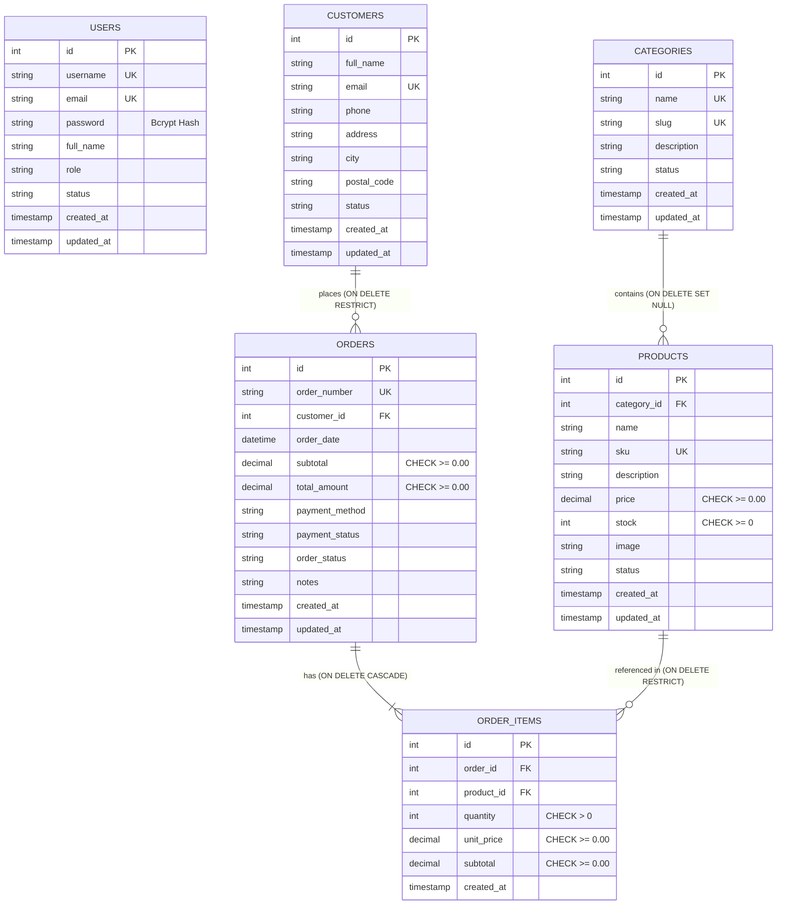

# ShopSphere – Database Architecture & Technical Documentation
> **University Web Engineering PBL Project**  
> **Phase 2: Complete MySQL Database Development**

[](https://mariadb.org/)
[](https://dev.mysql.com/doc/refman/8.0/en/innodb-storage-engine.html)
[]()
[]()

---

## 1. Database Overview

The **ShopSphere** database (`shopsphere_db`) is engineered to serve as the relational persistence foundation for a commercial-grade SaaS e-commerce management platform. Designed specifically for integration with **PHP PDO** in Phase 3, the schema enforces strict transactional data integrity, normalization, referential constraints, and optimized index structures.

### Key Architectural Specifications:
- **Database Name**: `shopsphere_db`
- **Storage Engine**: `InnoDB` (enables ACID compliance, row-level locking, foreign key integrity, and crash recovery).
- **Character Set**: `utf8mb4` (full four-byte UTF-8 support including international scripts and symbols).
- **Collation**: `utf8mb4_unicode_ci` (case-insensitive, linguistically accurate Unicode sorting).
- **Precision Monetary Types**: `DECIMAL(10,2)` utilized for all financial attributes (`price`, `subtotal`, `total_amount`, `unit_price`) to eliminate floating-point rounding discrepancies.
- **Audit Trails**: Automated `created_at` and `updated_at` timestamps on all entity headers.

---

## 2. Entity-Relationship (ER) Diagram

The diagram below illustrates all six relational tables, column definitions, primary keys (`PK`), foreign keys (`FK`), unique keys (`UK`), and relationship cardinalities.



---

## 3. Data Dictionary & Table Definitions

### 3.1. `users` Table
Stores administrator credentials and staff roles. Plaintext passwords are strictly prohibited; passwords are encrypted with standard PHP `password_hash()` bcrypt digests.

| Field Name | Data Type | Nullable | Default | Constraints | Description |
|---|---|---|---|---|---|
| `id` | `INT UNSIGNED` | NO | *AUTO_INCREMENT* | `PRIMARY KEY` | Unique internal user ID |
| `username` | `VARCHAR(50)` | NO | None | `UNIQUE`, `NOT NULL` | System login handle |
| `email` | `VARCHAR(100)` | NO | None | `UNIQUE`, `NOT NULL` | Administrative communication address |
| `password` | `VARCHAR(255)` | NO | None | `NOT NULL` | 60-character Bcrypt hash digest (`$2y$10$...`) |
| `full_name` | `VARCHAR(100)` | NO | None | `NOT NULL` | User's full personal name |
| `role` | `VARCHAR(30)` | NO | `'administrator'` | `INDEX` | Access tier (`administrator`, `store_manager`) |
| `status` | `VARCHAR(20)` | NO | `'active'` | `INDEX` | Account state (`active`, `suspended`, `inactive`) |
| `created_at` | `TIMESTAMP` | NO | `CURRENT_TIMESTAMP` | None | Initial account creation timestamp |
| `updated_at` | `TIMESTAMP` | NO | `CURRENT_TIMESTAMP` | `ON UPDATE CURRENT_TIMESTAMP` | Last profile update timestamp |

---

### 3.2. `categories` Table
Organizes products into navigable taxonomic departments.

| Field Name | Data Type | Nullable | Default | Constraints | Description |
|---|---|---|---|---|---|
| `id` | `INT UNSIGNED` | NO | *AUTO_INCREMENT* | `PRIMARY KEY` | Unique department ID |
| `name` | `VARCHAR(100)` | NO | None | `UNIQUE`, `NOT NULL` | Department name (e.g., *Gaming & VR*) |
| `slug` | `VARCHAR(100)` | YES | `NULL` | `UNIQUE` | URL-safe department slug (e.g., *gaming-vr*) |
| `description` | `TEXT` | YES | `NULL` | None | Detailed department description |
| `status` | `VARCHAR(20)` | NO | `'active'` | `INDEX` | Publication status (`active`, `inactive`) |
| `created_at` | `TIMESTAMP` | NO | `CURRENT_TIMESTAMP` | None | Department creation timestamp |
| `updated_at` | `TIMESTAMP` | NO | `CURRENT_TIMESTAMP` | `ON UPDATE CURRENT_TIMESTAMP` | Last department modification timestamp |

---

### 3.3. `products` Table
Maintains catalog inventory, item specifications, stock quantities, and base pricing.

| Field Name | Data Type | Nullable | Default | Constraints | Description |
|---|---|---|---|---|---|
| `id` | `INT UNSIGNED` | NO | *AUTO_INCREMENT* | `PRIMARY KEY` | Unique product identifier |
| `category_id` | `INT UNSIGNED` | YES | `NULL` | `FOREIGN KEY`, `INDEX` | References `categories(id)` via `ON DELETE SET NULL` |
| `name` | `VARCHAR(150)` | NO | None | `NOT NULL` | Commercial product title |
| `sku` | `VARCHAR(50)` | NO | None | `UNIQUE`, `NOT NULL` | Stock Keeping Unit code (e.g., `SP-15PM-256`) |
| `description` | `TEXT` | YES | `NULL` | None | Complete marketing and technical details |
| `price` | `DECIMAL(10,2)` | NO | `0.00` | `CHECK (price >= 0.00)`, `INDEX` | Base retail sales price in store currency |
| `stock` | `INT` | NO | `0` | `CHECK (stock >= 0)` | Available physical inventory units |
| `image` | `VARCHAR(255)` | YES | `NULL` | None | Primary image asset URL or local path |
| `status` | `VARCHAR(20)` | NO | `'active'` | `INDEX` | Catalog status (`active`, `inactive`) |
| `created_at` | `TIMESTAMP` | NO | `CURRENT_TIMESTAMP` | None | Record creation timestamp |
| `updated_at` | `TIMESTAMP` | NO | `CURRENT_TIMESTAMP` | `ON UPDATE CURRENT_TIMESTAMP` | Record modification timestamp |

---

### 3.4. `customers` Table
Maintains customer profiles, contact phone numbers, and default shipping addresses.

| Field Name | Data Type | Nullable | Default | Constraints | Description |
|---|---|---|---|---|---|
| `id` | `INT UNSIGNED` | NO | *AUTO_INCREMENT* | `PRIMARY KEY` | Unique customer account ID |
| `full_name` | `VARCHAR(100)` | NO | None | `NOT NULL` | Customer's complete legal name |
| `email` | `VARCHAR(100)` | NO | None | `UNIQUE`, `NOT NULL` | Primary email contact and login identity |
| `phone` | `VARCHAR(30)` | YES | `NULL` | `INDEX` | Contact phone number |
| `address` | `TEXT` | YES | `NULL` | None | Default street delivery address |
| `city` | `VARCHAR(50)` | YES | `NULL` | `INDEX` | City of residence |
| `postal_code` | `VARCHAR(20)` | YES | `NULL` | None | Postal / ZIP code |
| `status` | `VARCHAR(20)` | NO | `'active'` | `INDEX` | Account state (`active`, `blocked`) |
| `created_at` | `TIMESTAMP` | NO | `CURRENT_TIMESTAMP` | None | Registration timestamp |
| `updated_at` | `TIMESTAMP` | NO | `CURRENT_TIMESTAMP` | `ON UPDATE CURRENT_TIMESTAMP` | Last profile update timestamp |

---

### 3.5. `orders` Table
Captures customer transaction headers, payment outcomes, fulfillment stages, and billing totals.

| Field Name | Data Type | Nullable | Default | Constraints | Description |
|---|---|---|---|---|---|
| `id` | `INT UNSIGNED` | NO | *AUTO_INCREMENT* | `PRIMARY KEY` | Internal transactional order ID |
| `order_number` | `VARCHAR(30)` | NO | None | `UNIQUE`, `NOT NULL` | Human-readable order code (e.g., `ORD-7081`) |
| `customer_id` | `INT UNSIGNED` | NO | None | `FOREIGN KEY`, `INDEX` | References `customers(id)` via `ON DELETE RESTRICT` |
| `order_date` | `DATETIME` | NO | `CURRENT_TIMESTAMP` | `INDEX` | Exact timestamp order was finalized |
| `subtotal` | `DECIMAL(10,2)` | NO | `0.00` | `CHECK (subtotal >= 0.00)` | Sum of product line item subtotals |
| `total_amount` | `DECIMAL(10,2)` | NO | `0.00` | `CHECK (total_amount >= 0.00)` | Final amount charged after tax and shipping |
| `payment_method` | `VARCHAR(50)` | NO | `'Credit Card'` | None | Payment channel (`Credit Card`, `PayPal`, `Bank Transfer`, `Cash on Delivery`) |
| `payment_status` | `VARCHAR(20)` | NO | `'pending'` | `INDEX` | Financial state (`paid`, `pending`, `failed`, `refunded`) |
| `order_status` | `VARCHAR(20)` | NO | `'pending'` | `INDEX` | Fulfillment stage (`pending`, `processing`, `shipped`, `delivered`, `cancelled`) |
| `notes` | `TEXT` | YES | `NULL` | None | Delivery instructions or concierge notes |
| `created_at` | `TIMESTAMP` | NO | `CURRENT_TIMESTAMP` | None | Record insertion timestamp |
| `updated_at` | `TIMESTAMP` | NO | `CURRENT_TIMESTAMP` | `ON UPDATE CURRENT_TIMESTAMP` | Status change timestamp |

---

### 3.6. `order_items` Table
Itemized breakdown of products contained within each order. 

> [!IMPORTANT]
> **Historical Price Snapshot**: The `unit_price` field captures the product's price at the precise moment of purchase. If a product's price in the `products` table changes later, historical invoices and revenue reports remain mathematically accurate and tamper-proof.

| Field Name | Data Type | Nullable | Default | Constraints | Description |
|---|---|---|---|---|---|
| `id` | `INT UNSIGNED` | NO | *AUTO_INCREMENT* | `PRIMARY KEY` | Unique line item ID |
| `order_id` | `INT UNSIGNED` | NO | None | `FOREIGN KEY`, `INDEX` | References `orders(id)` via `ON DELETE CASCADE` |
| `product_id` | `INT UNSIGNED` | NO | None | `FOREIGN KEY`, `INDEX` | References `products(id)` via `ON DELETE RESTRICT` |
| `quantity` | `INT` | NO | `1` | `CHECK (quantity > 0)` | Number of units purchased |
| `unit_price` | `DECIMAL(10,2)` | NO | None | `CHECK (unit_price >= 0.00)` | Historical unit price snapshot at checkout |
| `subtotal` | `DECIMAL(10,2)` | NO | None | `CHECK (subtotal >= 0.00)` | Calculated as `quantity * unit_price` |
| `created_at` | `TIMESTAMP` | NO | `CURRENT_TIMESTAMP` | None | Line item record creation timestamp |

---

## 4. Referential Integrity & Foreign Key Policies

To ensure commercial-grade robustness, deletion policies are strictly tailored to real-world business accounting rules:

1. **`products.category_id` &rarr; `categories.id` (`ON DELETE SET NULL`)**:
   - If an administrator deletes a product department (category), catalog products are **not deleted**. Their `category_id` is safely transitioned to `NULL` (uncategorized), preventing inventory loss.
2. **`orders.customer_id` &rarr; `customers.id` (`ON DELETE RESTRICT`)**:
   - Customers who have placed historical orders **cannot be deleted**. The database engine rejects deletion attempts, preserving audit trails and tax records.
3. **`order_items.order_id` &rarr; `orders.id` (`ON DELETE CASCADE`)**:
   - If an order record is explicitly removed, all associated itemized lines in `order_items` are automatically purged in tandem.
4. **`order_items.product_id` &rarr; `products.id` (`ON DELETE RESTRICT`)**:
   - A product that has been sold in historical orders cannot be deleted from the database. The administrator must archive the product (`status = 'inactive'`) rather than destroying sales history.

---

## 5. Sample Administrator Login Credentials

For testing and presentation evaluation, a pre-seeded administrative user has been provisioned:

- **Login URL**: `index.html` (simulated frontend) / `http://localhost/shopsphere` (Phase 3)
- **Username**: `admin`
- **Email**: `admin@shopsphere.io`
- **Password**: `Admin@123`
- **Password Hash Algorithm**: `PASSWORD_BCRYPT` (Cost: 10)
- **Stored Hash in Database**:  
  `$2y$10$Fav8jb7jkvI4QV/dVJWcNO3B6mmgMizBKyhsyI1Ir2VsvdAUwIjHK`

*Verification with native PHP:*
```php
password_verify('Admin@123', '$2y$10$Fav8jb7jkvI4QV/dVJWcNO3B6mmgMizBKyhsyI1Ir2VsvdAUwIjHK'); // Returns true
```

---

## 6. Verification Queries & Analytical Results

All SQL queries required for administrative reporting were tested and executed against the schema:

### Query 1: Total Catalog Products
```sql
SELECT COUNT(*) AS total_products FROM products;
```
**Result**: `16 products` (spanning flagships, audio, laptops, smart home, and accessories).

### Query 2: Total Registered Customers
```sql
SELECT COUNT(*) AS total_customers FROM customers;
```
**Result**: `12 customers` (11 active, 1 blocked).

### Query 3: Total Orders & Completed Revenue
```sql
SELECT 
    COUNT(*) AS total_orders,
    SUM(CASE WHEN payment_status = 'paid' THEN total_amount ELSE 0.00 END) AS total_revenue
FROM orders;
```
**Result**: `12 orders` | Total Paid Revenue: **\$11,913.44**.

### Query 4: Products Grouped by Department
```sql
SELECT 
    c.name AS category_name,
    COUNT(p.id) AS product_count,
    ROUND(AVG(p.price), 2) AS average_price
FROM categories c
LEFT JOIN products p ON c.id = p.category_id
GROUP BY c.id, c.name
ORDER BY product_count DESC;
```
**Result**:
| Department Name | Product Count | Average Price |
|---|---|---|
| Laptops & Computers | 3 | \$1,515.67 |
| Gaming & VR | 3 | \$406.16 |
| Smartphones & Tablets | 2 | \$1,149.00 |
| Audio & Headphones | 2 | \$249.00 |
| Wearables & Smartwatches | 2 | \$234.00 |
| Smart Home & IoT | 2 | \$134.00 |
| Accessories & Cables | 2 | \$54.75 |

### Query 5: Orders Grouped by Status
```sql
SELECT 
    order_status,
    COUNT(*) AS order_count,
    SUM(total_amount) AS total_status_value
FROM orders
GROUP BY order_status
ORDER BY order_count DESC;
```
**Result**:
| Order Status | Order Count | Total Value |
|---|---|---|
| Pending | 4 | \$3,759.00 |
| Processing | 3 | \$3,303.98 |
| Delivered | 2 | \$4,778.28 |
| Shipped | 2 | \$1,163.23 |
| Cancelled | 1 | \$1,300.92 |

### Query 6: Comprehensive Multi-Table Order Details (Join)
```sql
SELECT 
    o.order_number,
    o.order_date,
    c.full_name AS customer_name,
    p.name AS product_name,
    p.sku,
    oi.quantity,
    oi.unit_price,
    oi.subtotal,
    o.total_amount AS order_grand_total,
    o.payment_status,
    o.order_status
FROM orders o
JOIN customers c ON o.customer_id = c.id
JOIN order_items oi ON o.id = oi.order_id
JOIN products p ON oi.product_id = p.id
ORDER BY o.id ASC, oi.id ASC;
```

---

## 7. How to Import `shopsphere.sql` into XAMPP phpMyAdmin

### Step 1: Start XAMPP Services
1. Open the **XAMPP Control Panel**.
2. Click **Start** beside the **Apache** module.
3. Click **Start** beside the **MySQL** module.
4. Verify that both modules display a green indicator with active port numbers (Apache: `80, 443`, MySQL: `3306`).

### Step 2: Open phpMyAdmin
1. Open your web browser and navigate to:  
   `http://localhost/phpmyadmin/`

### Step 3: Import the SQL File
1. In the top navigation bar of phpMyAdmin, click the **Import** tab.
2. Click **Choose File** (or Browse) and select:  
   `C:\Shopsphere\database\shopsphere.sql`
3. Ensure the format dropdown is set to **SQL**.
4. Scroll to the bottom and click the **Import** (or **Go**) button.
5. phpMyAdmin will execute the script, create `shopsphere_db`, build all 6 tables, enforce constraints, and insert all sample seed records with a green success message:  
   *`"Import has been successfully finished, queries executed."`*

### Alternative: Import via Command Line
If preferred, you can also import directly from Windows PowerShell:
```powershell
C:\xampp\mysql\bin\mysql.exe -u root -p < C:\Shopsphere\database\shopsphere.sql
```
*(Press Enter if no MySQL root password is set in default XAMPP).*

---

## 8. Database Backup & Export Instructions via phpMyAdmin

Backing up the `shopsphere_db` database is essential before performing migrations, data resets, or final project submissions.

### Step-by-Step phpMyAdmin Export Process:
1. Open your browser and navigate to `http://localhost/phpmyadmin/`.
2. In the left-hand database tree, click on **`shopsphere_db`**.
3. In the top navigation bar, click the **Export** tab.
4. **Export Method Options**:
   - **Quick** *(Recommended for standard submissions)*: Select `Quick - display only the minimal options`.
   - **Custom**: If you need gzip compression or specific options (e.g. `Add DROP TABLE / VIEW / PROCEDURE / FUNCTION` statement), select `Custom`, check all 6 tables, and choose `gzipped` under the Output section.
5. Set Format to **SQL**.
6. Click **Export** (or **Go**).
7. Save the resulting file as `shopsphere_db_backup_[YYYY-MM-DD].sql`.

### Backing Up via MySQL CLI:
```powershell
# Create an instantaneous SQL dump of the database
C:\xampp\mysql\bin\mysqldump.exe -u root -p shopsphere_db > C:\Shopsphere\database\shopsphere_db_backup.sql
```

---

## 9. Production Deployment Database (`DEPLOYMENT_DATABASE.sql`)

For fresh deployments, cloud hosting, and university grading, the canonical setup file is:
[`database/DEPLOYMENT_DATABASE.sql`](file:///c:/Shopsphere/database/DEPLOYMENT_DATABASE.sql)

This consolidated script:
1. Provisions `shopsphere_db` with `utf8mb4` character set and `utf8mb4_unicode_ci` collation.
2. Creates all 6 tables in strict relational dependency order (`users`, `categories`, `products`, `customers`, `orders`, `order_items`).
3. Embeds the `slug` column natively within `categories` with a unique constraint.
4. Implements all InnoDB foreign keys with referential actions (`CASCADE`, `RESTRICT`, `SET NULL`).
5. Applies data-level integrity checks (`CHECK (price >= 0.00)`, `CHECK (stock >= 0)`, `CHECK (quantity > 0)`).
6. Seeds the database with pre-configured administrator accounts, taxonomy categories, 16 commercial products, 12 customer dossiers, and 12 complete orders with 20 itemized line items.
  - Phase 3 will introduce a `/backend` directory containing PDO database configuration (`config/database.php`), authenticated REST API routes (`api/products.php`, `api/orders.php`, etc.), session handling, and replacing browser `localStorage` calls with native `fetch()` requests.

