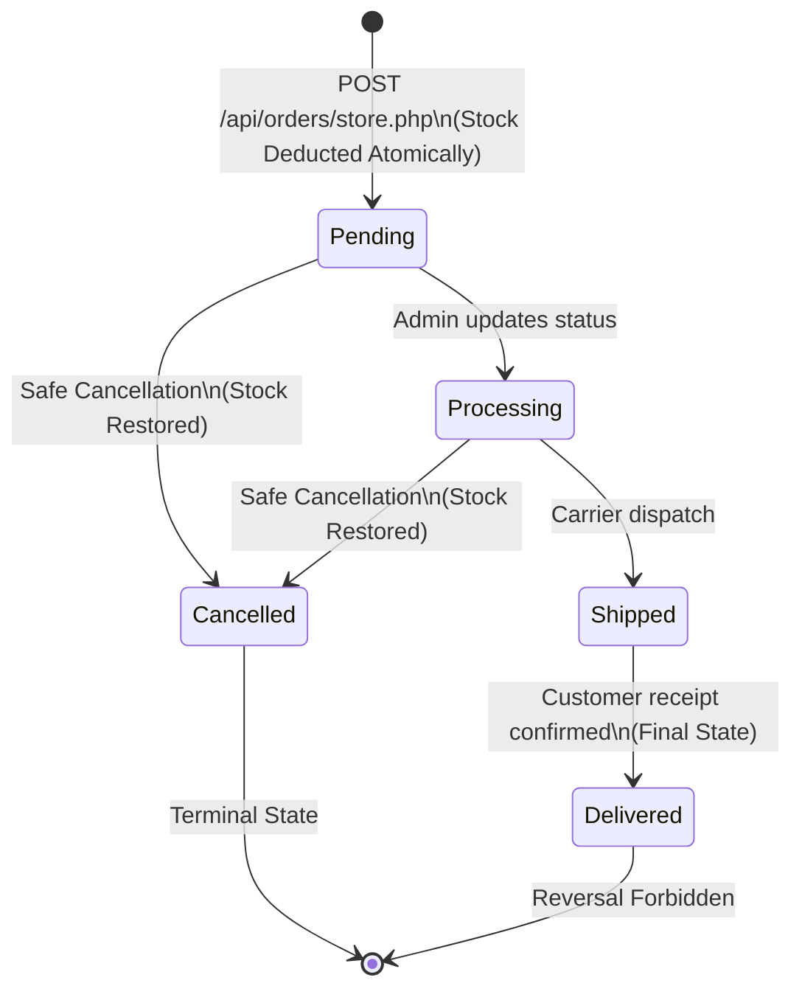

# ShopSphere – System Architecture Specification
> **Course**: University Web Engineering PBL (SW417)  
> **Project Title**: ShopSphere – E-Commerce Management System  
> **Document**: Technical System Architecture & Engineering Blueprint

---

## 1. Architectural Philosophy & Design Principles

**ShopSphere** is engineered as a decoupled, layered full-stack application that leverages standard browser capabilities and modern native PHP runtime features. The architecture adheres to five core engineering principles:

1. **Separation of Concerns (SoC)**: Clear division between Presentation (HTML5/CSS3/JS), Application & Routing (PHP API Endpoints), Business Validation (`includes/validation.php`, `auth.php`), and Persistence (MySQL InnoDB).
2. **Stateless API Communication**: Communication between client and server occurs via JSON payloads over standard HTTP methods (`GET`, `POST`), while maintaining state solely through secure, hardened session cookies.
3. **Defense-in-Depth Security**: Multiple overlapping security controls: input validation, prepared statements, cryptographic CSRF tokens, output encoding, and web server execution restrictions.
4. **ACID Transaction Guarantees**: Multi-table state mutations (e.g. order placement, stock decrement, customer balance calculation) are wrapped in atomic database transactions with row-level locks.
5. **Zero External Runtime Bloat**: Zero reliance on heavyweight frameworks (React, Angular, Laravel, Symfony), making the entire codebase lean, auditable, performant, and trivial to deploy on standard XAMPP stacks.

---

## 2. Multi-Tier Layered Architecture Diagram

```
┌─────────────────────────────────────────────────────────────────────────────┐
│                             TIER 1: PRESENTATION                            │
│  Browser Client (HTML5 / Modern CSS3 / Vanilla JavaScript ES6+)            │
│                                                                             │
│  ┌───────────────────────┐  ┌───────────────────────┐  ┌──────────────────┐ │
│  │ HTML5 Semantic Pages  │  │ CSS3 Design System    │  │ JavaScript (ES6) │ │
│  │ - index.html (Auth)   │  │ - variables.css       │  │ - api.js         │ │
│  │ - dashboard.html      │  │ - components.css      │  │ - ui.js          │ │
│  │ - products.html       │  │ - dashboard.css       │  │ - store.js       │ │
│  │ - categories.html     │  │ - responsive.css      │  │ - modules/*.js   │ │
│  │ - customers.html      │  │ - style.css           │  │                  │ │
│  │ - orders.html         │  │                       │  │                  │ │
│  │ - settings.html       │  │                       │  │                  │ │
│  └───────────────────────┘  └───────────────────────┘  └──────────────────┘ │
└──────────────────────────────────────┬──────────────────────────────────────┘
                                       │ HTTP / HTTPS (JSON + Cookie + CSRF)
                                       ▼
┌─────────────────────────────────────────────────────────────────────────────┐
│                          TIER 2: WEB SERVER & GATEWAY                       │
│  Apache Web Server (XAMPP / Production LAMP)                                │
│                                                                             │
│  - Document Root: DirectoryIndex index.html                                 │
│  - Directory Protection: Options -Indexes                                   │
│  - Access Restriction (.htaccess): Blocks direct access to .env, config/,   │
│    database/, tests/, and logs                                              │
│  - Security Headers: X-Frame-Options, X-Content-Type-Options, nosniff       │
└──────────────────────────────────────┬──────────────────────────────────────┘
                                       │ Dispatched Request
                                       ▼
┌─────────────────────────────────────────────────────────────────────────────┐
│                     TIER 3: APPLICATION & BUSINESS LOGIC                     │
│  PHP 8+ Runtime Environment (REST-Inspired JSON API)                        │
│                                                                             │
│  ┌────────────────────────────────────────────────────────────────────────┐ │
│  │ API Endpoints (api/)                                                   │ │
│  │ - auth/       -> login.php, logout.php, me.php                         │ │
│  │ - categories/ -> index.php, show.php, store.php, update.php, destroy.php│ │
│  │ - products/   -> index.php, show.php, store.php, update.php, delete.php │ │
│  │ - customers/  -> index.php, show.php, store.php, update.php, delete.php │ │
│  │ - orders/     -> index.php, show.php, store.php, update.php, cancel.php  │ │
│  │ - health.php  -> System health & database ping                         │ │
│  └───────────────────────────────────┬────────────────────────────────────┘ │
│                                      │                                      │
│  ┌───────────────────────────────────┴────────────────────────────────────┐ │
│  │ Shared Framework Services (includes/ & config/)                        │ │
│  │ - config/app.php          -> .env loader, session hardening, errors   │ │
│  │ - config/database.php     -> PDO Singleton Connection Manager          │ │
│  │ - includes/auth.php       -> Session verification, Bcrypt, CSRF guards │ │
│  │ - includes/response.php   -> Standardized JSON envelope emitter        │ │
│  │ - includes/validation.php -> Server-side input & parameter validation  │ │
│  │ - includes/helpers.php    -> Request methods, sanitizers, JSON parsing │ │
│  │ - includes/upload.php     -> MIME validation, random hashing, uploads  │ │
│  │ - includes/category_helper.php -> Slug generator & schema auto-healer  │ │
│  └────────────────────────────────────────────────────────────────────────┘ │
└──────────────────────────────────────┬──────────────────────────────────────┘
                                       │ PDO Prepared Statements / SQL
                                       ▼
┌─────────────────────────────────────────────────────────────────────────────┐
│                            TIER 4: PERSISTENCE                              │
│  MySQL 8.0+ / MariaDB 10.4+ Database Engine (shopsphere_db)                 │
│                                                                             │
│  - Storage Engine: InnoDB (Full ACID compliance & Row Locking)              │
│  - Character Set: utf8mb4 | Collation: utf8mb4_unicode_ci                   │
│  - Foreign Keys:                                                            │
│    * fk_products_category   -> ON DELETE SET NULL                           │
│    * fk_orders_customer     -> ON DELETE RESTRICT                           │
│    * fk_order_items_order   -> ON DELETE CASCADE                            │
│    * fk_order_items_product -> ON DELETE RESTRICT                           │
│  - Check Constraints:                                                       │
│    * price >= 0.00, stock >= 0, quantity > 0, unit_price >= 0.00            │
└─────────────────────────────────────────────────────────────────────────────┘
```

---

## 3. Order Lifecycle & Inventory State Machine

The fulfillment and inventory lifecycle follows a deterministic finite state machine to prevent stock leakage, race conditions, and unauthorized cancellations:



### Transition Guards:
1. **Initial Entry Point**: All orders **must start in `pending` status**. Initial placement requests specifying `cancelled` or `delivered` are rejected with HTTP 422.
2. **Atomic Inventory Reservation**:
   ```sql
   UPDATE products 
   SET stock = stock - :quantity 
   WHERE id = :id AND stock >= :quantity;
   ```
   If `rowCount() === 0`, inventory was insufficient; the entire transaction rolls back immediately.
3. **Delivered State Immutability**: Orders marked `delivered` can never be reverted to `pending` or `cancelled`, preserving delivery audit trails and tax records.
4. **Cancellation Stock Restoration**: When an order is cancelled:
   - Line items are read from `order_items`.
   - Each product's stock is restored by the exact purchased quantity.
   - Restoration is executed **exactly once**. Subsequent cancellation attempts are rejected.
5. **Payment Status Refund Consistency**:
   - If an order was `paid`, cancellation forces `payment_status = 'refunded'`.
   - If an order was unpaid (`pending` or `failed`), cancellation preserves its unpaid state.

---

## 4. Security Architecture

ShopSphere implements defense-in-depth across the application stack:

```
[Incoming Request]
       │
       ▼
1. Web Server (.htaccess) ──────── Block direct access to .env, config/, database/, tests/
       │
       ▼
2. Session Hardening ──────────── HTTP-only, SameSite=Lax, strict mode, 7200s expiry
       │
       ▼
3. CSRF Verification ─────────── Cryptographic token matching X-CSRF-Token header on POST
       │
       ▼
4. Authentication Guard ───────── requireAuth() validates authenticated session
       │
       ▼
5. Input Validation ───────────── Validator checks types, lengths, required fields, enums
       │
       ▼
6. SQL Injection Defense ──────── 100% Parameterized PDO prepared statements
       │
       ▼
7. File Upload Hardening ──────── MIME check, extension denylist, random hash, .htaccess script lock
       │
       ▼
8. Stored XSS Defense ─────────── UI.escapeHtml() neutralizes strings before DOM injection
       │
       ▼
[Database / Response]
```

### Key Security Implementations:
1. **Password Security**: Passwords are never stored in plaintext. Passwords use Bcrypt via native PHP `password_hash($pass, PASSWORD_BCRYPT)` with cost factor 10. Verification uses `password_verify()`.
2. **Session Hijacking Defense**: On login, `session_regenerate_id(true)` is invoked to eliminate session fixation. Cookies have `HttpOnly` and `SameSite=Lax` flags set.
3. **CSRF Protection**: Stateful session token `$_SESSION['csrf_token']` is issued on login and refreshed. Mutating requests (`POST`) require matching `X-CSRF-Token` header.
4. **SQL Injection Defense**: Emulated prepares are disabled (`PDO::ATTR_EMULATE_PREPARES => false`). Every query uses parameterized placeholders (`:param`).
5. **Media Upload Sandboxing**: Files uploaded to `uploads/products/` receive a cryptographically random UUID/hash filename. The directory contains an `.htaccess` file disabling PHP engine execution (`php_flag engine off`) and blocking all executable extensions.

---

## 5. Frontend Client Architecture

The frontend is built using standard ES6+ modules without Node.js bundler dependencies:

1. **`assets/js/api.js`**: Centralized API abstraction service encapsulating `fetch()`. Handles automatic CSRF header injection (`X-CSRF-Token`), JSON payload serialization, and credentials handling (`credentials: 'same-origin'`).
2. **`assets/js/ui.js`**: Global UI component manager. Houses toast notification engine, modal confirmation dialogs, safe HTML escaping (`UI.escapeHtml()`), responsive sidebar toggling, dark/light theme switching, and session authentication heartbeat (`UI.checkAdminAuth()`).
3. **`assets/js/store.js`**: Fallback client-side repository. Enables complete offline demonstration testing when a PHP/MySQL server is not running (e.g. running directly via `file:///`).
4. **Module Controllers (`products.js`, `categories.js`, `customers.js`, `orders.js`, `dashboard.js`, `settings.js`)**: Isolated event listeners and view controllers managing specific pages.

---

## 6. Directory Structure & Component Taxonomy

```text
ShopSphere/
│
├── .env.example             # Production environment configuration template
├── .htaccess                # Apache security rules, sensitive directory protection
│
├── config/                  # Configuration Layer
│   ├── app.php              # Environment loader, error reporting & session hardening
│   └── database.php         # PDO Singleton Database Connection Manager
│
├── includes/                # Shared Application Framework
│   ├── auth.php             # Authentication, Bcrypt hashing & CSRF tokens
│   ├── category_helper.php  # Category slug generation & schema auto-migration
│   ├── helpers.php          # HTTP method checks, JSON parsers & string sanitizers
│   ├── response.php         # Standardized JSON response envelope engine
│   ├── upload.php           # Secure image upload handler
│   └── validation.php       # Server-side input & parameter validation classes
│
├── api/                     # REST API Controllers (JSON Endpoints)
│   ├── auth/                # login.php, logout.php, me.php
│   ├── categories/          # index.php, show.php, store.php, update.php, destroy.php
│   ├── products/            # index.php, show.php, store.php, update.php, delete.php, stats.php
│   ├── customers/           # index.php, show.php, store.php, update.php, delete.php, stats.php
│   ├── orders/              # index.php, show.php, store.php, update.php, cancel.php, stats.php
│   └── health.php           # System health & live database ping
│
├── database/                # Relational Persistence Layer
│   ├── DEPLOYMENT_DATABASE.sql # Canonical production DDL schema & seed data
│   ├── shopsphere.sql       # Baseline schema & sample records
│   ├── migrate_category_slug.sql # Category slug column migration
│   ├── DATABASE_DOCUMENTATION.md # Detailed schema data dictionary
│   └── verify_database.py   # Python automated database constraint test suite
│
├── assets/                  # Frontend Static Assets
│   ├── css/                 # variables.css, components.css, dashboard.css, responsive.css, style.css
│   └── js/                  # api.js, ui.js, store.js, dashboard.js, products.js, categories.js,
│                            # customers.js, orders.js, settings.js
│
├── tests/                   # Automated Quality Assurance & Verification
│   ├── run_all_tests.php    # Master automated test runner (207 tests)
│   ├── category_test.php    # Category CRUD verification (16 tests)
│   ├── order_test.php       # Order lifecycle & refund integrity (22 tests)
│   ├── product_test.php     # Product CRUD verification (20 tests)
│   ├── customer_test.php    # Customer CRUD verification (16 tests)
│   ├── security_test.php    # Application security & OWASP tests (22 tests)
│   ├── integration_test.php # End-to-end integration tests (15 tests)
│   ├── test_helper.php      # SQLite in-memory test database fixture
│   └── [baseline suites]   # backend_test.php, endpoints_test.php, etc.
│
├── uploads/products/        # Uploaded catalog media assets (.htaccess protected)
│
└── [HTML5 Pages]            # index.html, dashboard.html, products.html, categories.html,
                             # customers.html, orders.html, settings.html
```

